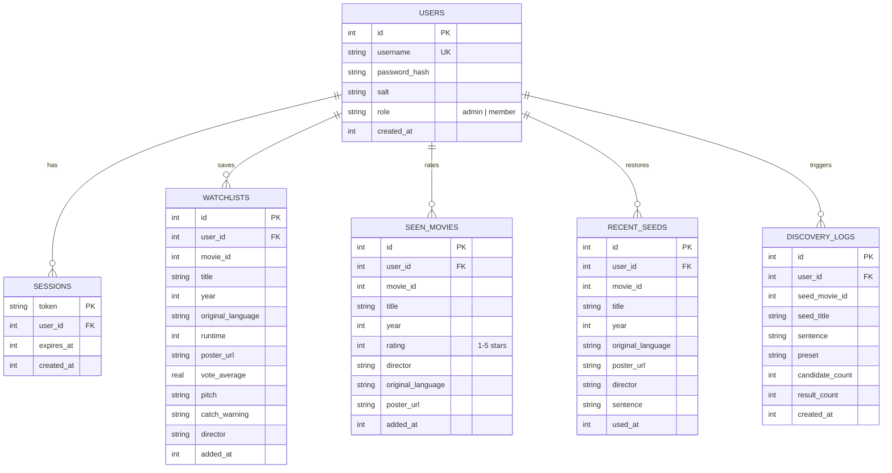

# kuro. — Design System & Architecture Specification

> **"One film. One sentence. Zero algorithm slop."**  
> An austere, deterministic horror movie discovery engine with a neo-brutalist Japanese editorial grid aesthetic (inspired by `finders-tokyo.co.jp`).

---

## 1. Core Philosophy & Visual Rules

kuro. eliminates modern SaaS bloat—no floating cards, no dropshadows, no neon gradients, and zero artificial telemetry jargon (no fake "98% match" or "synapse vectors"). The interface mirrors physical print, vintage Japanese editorial layouts, and revival cinema manifestos: stark, quiet, disciplined, and razor-sharp.

### Strict Visual Constraints (Zero Slop)
- **Sharp Geometry (`border-radius: 0px` globally)**: All containers, inputs, buttons, chips, poster bays, and modals have strictly 90-degree corners.
- **Hairline Division**: Visual hierarchy is created strictly through `1px solid #262629` hairlines, never drop shadows or elevation layers.
- **Zero Decorative Slop**: No glassmorphism, no gradient blurs, no skeuomorphic glows.
- **Grounded Information**: Every match displays authentic TMDB audience ratings (`★ 7.1`), an honest caveat (`CATCH: ...`), and verifiable outbound research links.

---

## 2. Color System

| Token | Hex Value | Purpose |
| :--- | :--- | :--- |
| **Canvas Black** | `#0A0A0B` | Deep abyssal background, root container fill |
| **Cell Black** | `#121214` | Inner frames, poster bays, input focus states |
| **Bone Ink** | `#F2EFE9` | Primary typography, active button backgrounds, titles |
| **Muted Ash** | `#8A8882` | Secondary metadata, labels, inactive borders, colophon |
| **Vermilion Accent**| `#E62E25` | Focal interaction color, Block 02 canvas, active star ratings |
| **Structural Hairline** | `#262629` | 1px border dividers, subtle grid rules |

---

## 3. Typography Hierarchy

Fonts are loaded via Google Fonts in `src/layouts/Layout.astro`.

| Category | Font Family | Usage |
| :--- | :--- | :--- |
| **Editorial Display** | `'Instrument Serif'`, `'Cormorant Garamond'`, serif | Wordmark logo, film titles, 26px sentence textarea, section kanji index (`黒`) |
| **Monospace Controls** | `'IBM Plex Mono'`, monospace | Subtitles, block index labels (`01 / SEED FILM`), ratings (`★ 7.1`), metadata tags, buttons |
| **Body Pitch** | `'Inter'`, sans-serif | 2-sentence grounded recommendation pitches, synopses |

---

## 4. Responsive 3-Column Grid Architecture

### Desktop View (`>= 1024px`)
Fixed full-viewport frame using `grid grid-cols-[1fr_430px_1fr] min-h-screen`:

```
┌─────────────────────────┬──────────────────────┬─────────────────────────┐
│ LEFT COLUMN (Sticky)    │ CENTER COLUMN (430px)│ RIGHT COLUMN (Sticky)   │
│                         │                      │                         │
│ • kuro. Oversized Brand │ • Header Bar         │ • Plan to Watch List    │
│ • "One film. One        │ • Block 01: Seed     │   (Taste affinity sort) │
│    sentence. Zero       │ • Block 02: Sentence │ • Recent Seeds          │
│    algorithm slop."     │ • Block 03: Presets  │   (With saved sentence) │
│ • Dynamic Poster Stage  │ • Block 04: Results  │ • Already Seen Archive  │
│ • Editorial Colophon    │                      │   (5-Star ratings/undo) │
└─────────────────────────┴──────────────────────┴─────────────────────────┘
```

#### 1. Left Column (`sticky top-0 h-screen p-8 flex flex-col justify-between border-r border-[#262629]`):
- **Oversized Serif Wordmark**: `kuro.` with Vermilion period + subtitle.
- **Dynamic Poster Stage**: When a seed movie is selected, renders a stark `1px` framed 2:3 TMDB poster with director, year, and language. When empty, displays a stark minimal typographic mark (`黒` / `— 00 —` / `NO SEED SELECTED`).
- **Footer Colophon**: `GRID / TOKYO EDITORIAL` and `FINDERS ARCHIVE`.

#### 2. Center Column (`w-[430px] mx-auto min-h-screen border-x border-[#262629]`):
- **Header Bar (`h-12 px-4 flex items-center justify-between border-b`):**
  - Left: `kuro.` wordmark.
  - Right: Mobile toggle buttons for `PLAN [N]` and `SEEN [N]`.
- **Block 01 / SEED FILM:**
  - Search input with 250ms debounced TMDB dropdown overlay.
  - 3 quick-seed chips: `Incantation '22`, `Cure '97`, `Noroi '05`.
  - Selected state: Compact horizontal ticket strip with thumbnail, serif title, runtime, top 4 keyword tags, and `[CHANGE]` button.
  - *Behavioral Rule*: Any seeded or searched movie is automatically committed to the Already Seen archive.
- **Block 02 / THE SENTENCE CANVAS:**
  - Full-bleed Vermilion `#E62E25` background with `#0A0A0B` text.
  - Live character counter: `0 / 140`.
  - Borderless auto-resizing `<textarea maxLength={140}>` rendered in `26px Instrument Serif`.
  - 3 starter pills with `1px border-black` for instant inspiration.
- **Block 03 / POOL & TRIGGER:**
  - 3 equal-width preset cells: `ALL` | `CULT GEMS` | `FOREIGN`.
  - Full-bleed high-contrast CTA button (`FIND 3 MATCHES →`).
- **Block 04 / RESULTS STACK:**
  - Pool header: `CURATED FROM {N} VERIFIED CANDIDATES`.
  - 1 to 3 stacked editorial match rows:
    - Left: 76px 2:3 TMDB poster with authentic rating badge (`★ {voteAverage}`).
    - Right: Serif title, `YEAR · LANG · RUNTIME`, 2-sentence grounded pitch.
    - Bordered monospace caveat box: `CATCH: {catchWarning}` (honest notice on pacing, gore, or tone).
    - Outbound research links: `r/horror ↗`, `YouTube ↗`, `Stremio ↗` / `Letterboxd ↗`.
    - Action buttons: `[+ PLAN]` / `[PLAN ✓]`, `[USE AS SEED]`, `[MARK SEEN]`.

#### 3. Right Column (`sticky top-0 h-screen p-8 flex flex-col justify-between border-l border-[#262629] overflow-y-auto`):
- **Plan to Watch (Watchlist)**:
  - Saved recommendations dynamically sorted by taste affinity (director overlap with 4–5★ watched films, and high-rated language categories).
  - Compact cards with poster, title, year/language, `[SEED]`, `[SEEN]`, and `[✕]`.
- **Recent Seeds**:
  - Last 5 searched/used seed films.
  - Displays movie title, metadata, and the saved 140-char sentence in quotation marks.
  - 1-click `LOAD →` restores both the seed film and the sentence into the canvas.
- **Already Seen Archive**:
  - Blacklisted films with interactive 5-star ratings (`★ ★ ★ ★ ★`), `[UNDO]`, and `CLEAR`.
  - Automatically excludes blacklisted films from future discovery results.

### Mobile View (`< 1024px`)
- Single centered 430px column (`max-w-[430px] mx-auto border-x border-[#262629]`).
- Left and right desktop columns collapse cleanly.
- Header buttons `PLAN [N]` and `SEEN [N]` open a sharp, lightweight slide-down drawer with 1-click access to watchlist and blacklist actions.

---

## 5. Component Modularization

The frontend React architecture is decomposed into focused, single-responsibility components in `src/components/`:

- `KuroApp.tsx`: Main page coordinator managing auth session state, backend user synchronization, and layout structure.
- `LeftColumn.tsx`: Desktop left column branding, dynamic poster stage, and colophon.
- `SeedFilmSection.tsx`: Block 01 search input, debounced dropdown, quick seeds, and active ticket strip.
- `SentenceCanvas.tsx`: Block 02 Vermilion sentence canvas, auto-resizing textarea, counter, and starter pills.
- `PresetTrigger.tsx`: Block 03 preset buttons and discovery CTA button.
- `ResultsStack.tsx`: Block 04 verified candidate count and editorial recommendation cards.
- `RightColumn.tsx`: Desktop right column archives (Plan to Watch, Recent Seeds, Already Seen).
- `MobileDrawer.tsx`: Lightweight mobile drawer for watchlist and blacklist management.
- `PosterImage.tsx`: Image rendering with error boundary fallback and lazy loading.
- `AuthModal.tsx`: Editorial modal for user sign in and account registration.
- `AdminPanel.tsx`: Full administrative control panel for user RBAC management and telemetry audit logs.

---

## 6. Deterministic Backend & Discovery Pipeline

```mermaid
flowchart TD
    A["User Input: Seed Film + Sentence + Preset"] --> B["Stage 1: Intent Decomposition (LLM)"]
    B -->|Keywords & Mechanics| C["Stage 2: Deterministic TMDB Waterfall"]
    C -->|Seed Neighbors & Discover (Language-Agnostic)| D["Verified Candidate Pool (5–20 Candidates)"]
    D --> E["Stage 3: Grounded Cross-Encoder Reranking (LLM)"]
    E -->|1–3 Winning Matches| F["Hydrate External IDs (IMDb) & Runtime"]
    F --> G["Block 04: Editorial Results Stack"]
```

1. **Intent Decomposition (Stage 1)**:
   - LLM extracts 2–5 TMDB keywords, core horror mechanic, and tropes to avoid.
   - Dynamic text tokenization fallback guarantees zero crashes when offline or rate-limited.
2. **Deterministic Waterfall (Stage 2)**:
   - **Language-Agnostic Discovery**: Queries TMDB recommendations, similar titles, and keyword discovery globally without artificial language silos.
   - Presets apply verified rating floors (`vote_average >= 4.8`) and vote bounds (`cult`: 30–1500 votes, `foreign`: without English, `all`: 30+ votes).
   - Guarantees 5 to 20 deduplicated candidates.
3. **Grounded Reranking (Stage 3)**:
   - Evaluates candidates strictly against the user's sentence.
   - Outputs 2-sentence grounded pitch and honest `CATCH` caveat.
   - Robust 429 rate-limit backoff with multi-provider failover (Gemini models, Groq, OpenRouter).

---

## 7. Multi-User Architecture & Role-Based Access Control (RBAC)

kuro. features a self-contained, multi-tenant persistence layer using Node's native `node:sqlite` engine (`data/kuro.db`) with zero external binary dependencies.

### Security & Session Engine
- **Password Hashing**: Cryptographically secure salted `scrypt` hashing (64-byte key length with random 16-byte salt) paired with `timingSafeEqual` comparison to eliminate timing-attack vectors.
- **Session Tokens**: 32-byte cryptographically secure hexadecimal tokens stored in the `sessions` table.
- **Cookie Security**: Handled via `HttpOnly`, `SameSite=Lax`, `Path=/`, and conditional `Secure` cookies with 30-day expiration (`kuro_session`).

### 2-Tier RBAC Permission Matrix

| Capability | Member | Admin |
| :--- | :---: | :---: |
| Search Horror Titles & Hydrate Seeds | ✓ | ✓ |
| Execute Deterministic 3-Tier Discovery | ✓ | ✓ |
| Private Watchlist (Taste affinity sorted) | ✓ | ✓ |
| Private Seen Archive (5-star ratings & blacklist) | ✓ | ✓ |
| Private Recent Seeds (Quote preservation) | ✓ | ✓ |
| Access Administrative Panel | ✗ | ✓ |
| View System Metrics & Discovery Audit Logs | ✗ | ✓ |
| Promote / Demote User Roles (`admin` ↔ `member`) | ✗ | ✓ |
| Delete User Accounts & Cascade Associated Data | ✗ | ✓ |

### Guest Session Privacy & Data Isolation
- **No Cross-User Leaks**: Non-authenticated visitors operate in a read-only exploration mode. Watchlists, recent seeds, and seen blacklists remain strictly empty for guest sessions.
- **Editorial Sign-In Prompts**: Guest interactions targeting personal archives (e.g., adding to watchlist, rating/blacklisting a film, accessing saved seeds) trigger an in-place editorial authentication modal.
- **Admin Data Binding**: All baseline and pre-existing horror archives (12 verified seen films with ratings, recent seeds with sentence prompts, and watchlist items) are bound strictly to the `admin` user account (`user_id = 1`) in `node:sqlite`.

### Multi-User Database Schema



### Endpoints
- **Authentication**: `POST /api/auth/register`, `POST /api/auth/login`, `POST /api/auth/logout`, `GET /api/auth/me`
- **User Library**: `GET /api/user/library`, `POST /api/user/library`, `POST /api/user/watchlist`, `DELETE /api/user/watchlist`, `POST /api/user/seen`, `PATCH /api/user/seen`, `DELETE /api/user/seen`, `POST /api/user/recent-seeds`
- **RBAC Administration**: `GET /api/admin/users`, `PATCH /api/admin/users`, `DELETE /api/admin/users`, `GET /api/admin/stats`
