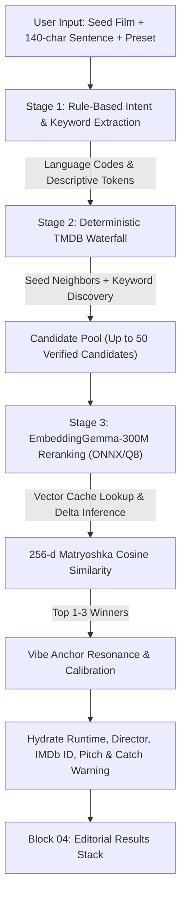
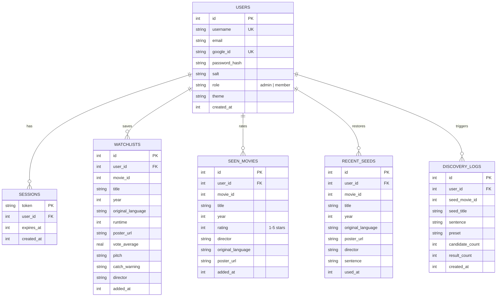

# kuro. — Design System & Architecture Specification

> **"One film. One sentence. Zero algorithm slop."**  
> An austere, deterministic horror movie discovery engine with a neo-brutalist Japanese editorial grid aesthetic.

---

## 1. Core Philosophy & Visual Rules

kuro. eliminates modern SaaS bloat—no floating cards, no dropshadows, no neon gradients, and zero artificial telemetry jargon (no fake "98% match" or "synapse vectors"). The interface mirrors physical print, vintage Japanese editorial layouts, and revival cinema manifestos: stark, quiet, disciplined, and razor-sharp.

### Strict Visual Constraints (Zero Slop)
- **Sharp Geometry (`border-radius: 0px` globally)**: All containers, inputs, buttons, chips, poster bays, and modals have strictly 90-degree corners.
- **Hairline Division**: Visual hierarchy is created strictly through `1px solid #262629` hairlines, never drop shadows or elevation layers.
- **Zero Decorative Slop**: No glassmorphism, no gradient blurs, no skeuomorphic glows.
- **Grounded Information**: Every match displays authentic TMDB audience ratings (`★ 7.1`), an honest caveat (`CATCH: ...`), deterministic vibe anchors, and verifiable outbound research links.

---

## 2. Color System & Dynamic Accent Engine

kuro. uses an abyssal, high-contrast dark foundation paired with an adjustable typographic accent system:

| Token | CSS Variable / Value | Purpose |
| :--- | :--- | :--- |
| **Canvas Black** | `#0A0A0B` | Deep abyssal background, root container fill |
| **Cell Black** | `#121214` | Inner frames, poster bays, input focus states |
| **Bone Ink** | `#F2EFE9` | Primary typography, active button backgrounds, titles |
| **Muted Ash** | `#8A8882` | Secondary metadata, labels, inactive borders, colophon |
| **Active Accent** | `var(--accent)` | Dynamic focal interaction color, Sentence Canvas, star ratings |
| **Accent RGB** | `var(--accent-rgb)` | RGB triplet for alpha-blended hover states and borders |
| **Structural Hairline** | `#262629` | 1px border dividers, subtle grid rules |

### Accent Presets
Managed via `AccentSwitcher.svelte` and persisted across client sessions (`localStorage`) and authenticated accounts (`/api/user/theme`):
1. **Crimson** (Default): `#E62E25` (`rgb(230, 46, 37)`) — Iconic revival cinema red.
2. **Amber**: `#FF6B00` (`rgb(255, 107, 0)`) — Warm sodium-vapor cinephile glow.
3. **Acid**: `#00E676` (`rgb(0, 230, 118)`) — Fluorescent VHS / night-vision green.
4. **Custom**: User-defined hex code with auto-computed RGB triplet.

---

## 3. Typography Hierarchy

Fonts are loaded via Google Fonts in `src/app.html`:

| Category | Font Family | Usage |
| :--- | :--- | :--- |
| **Editorial Display** | `'Instrument Serif'`, serif | Wordmark logo, film titles, 26px sentence textarea, section kanji index (`黒`) |
| **Monospace Controls** | `'IBM Plex Mono'`, monospace | Subtitles, block index labels (`01 / SEED FILM`), ratings (`★ 7.1`), metadata tags, buttons |
| **Body Pitch** | `'Inter'`, sans-serif | 2-sentence grounded recommendation pitches, synopses |

---

## 4. Responsive 3-Column Grid Architecture

### Desktop View (`>= 1024px`)
Fixed full-viewport frame using `grid grid-cols-[1fr_430px_1fr] min-h-screen`:

```
┌─────────────────────────┬──────────────────────┬─────────────────────────┐
│ LEFT COLUMN (Sticky)    │ CENTER COLUMN (430px)│ RIGHT COLUMN (Sticky)   │
│                         │                      │                         │
│ • kuro. Oversized Brand │ • TopBar & Auth      │ • Plan to Watch List    │
│ • "One film. One        │ • Block 01: Seed     │   (Taste affinity sort) │
│    sentence. Zero       │ • Block 02: Sentence │ • Recent Seeds          │
│    algorithm slop."     │ • Block 03: Presets  │   (With saved sentence) │
│ • Dynamic Poster Stage  │ • Block 04: Results  │ • Already Seen Archive  │
│ • Accent Theme Switcher │                      │   (5-Star ratings/undo) │
│ • Editorial Colophon    │                      │                         │
└─────────────────────────┴──────────────────────┴─────────────────────────┘
```

#### 1. Left Column (`sticky top-0 h-screen p-8 flex flex-col justify-between border-r border-[#262629]`):
- **Oversized Serif Wordmark**: `kuro.` with Accent period + subtitle.
- **Dynamic Poster Stage**: When a seed movie is selected, renders a stark `1px` framed 2:3 TMDB poster with director, year, and language. When empty, displays a stark minimal typographic mark (`黒` / `— 00 —` / `NO SEED SELECTED`).
- **Accent Theme Switcher**: 1-click toggles for Crimson, Amber, Acid, and Custom color picker.
- **Footer Colophon**: `GRID / TOKYO EDITORIAL` and `CINEMA ARCHIVE`.

#### 2. Center Column (`w-[430px] mx-auto min-h-screen border-x border-[#262629]`):
- **TopBar (`h-12 px-4 flex items-center justify-between border-b border-[#262629]`):**
  - Left: `kuro.` wordmark.
  - Right: Auth status (Login / User menu) and mobile toggle buttons for `PLAN [N]` and `SEEN [N]`.
- **Block 01 / SEED FILM:**
  - Search input with 250ms debounced TMDB dropdown overlay.
  - 3 quick-seed chips: `Incantation '22`, `Cure '97`, `Noroi '05`.
  - Selected state: Compact horizontal ticket strip with thumbnail, serif title, runtime, top 4 keyword tags, and `[CHANGE]` button.
  - *Behavioral Rule*: Any seeded or searched movie is automatically committed to the Already Seen archive.
- **Block 02 / THE SENTENCE CANVAS:**
  - Full-bleed accent `var(--accent)` background with high-contrast text.
  - Live character counter: `0 / 140`.
  - Borderless auto-resizing `<textarea maxLength={140}>` rendered in `26px Instrument Serif`.
  - 3 starter pills with `1px border-black` for instant inspiration.
- **Block 03 / POOL & TRIGGER:**
  - 3 equal-width preset cells: `ALL` | `CULT GEMS` | `FOREIGN`.
  - Full-bleed high-contrast CTA button (`FIND 3 MATCHES →`).
- **Block 04 / RESULTS STACK:**
  - Pool header: `CURATED FROM {N} VERIFIED CANDIDATES`.
  - 1 to 3 stacked editorial match rows:
    - Left: 76px 2:3 TMDB poster with authentic rating badge (`★ {voteAverage}`).
    - Right: Serif title, `YEAR · LANG · RUNTIME`, calibrated similarity % (`89% MATCH`), deterministic vibe anchor explanation.
    - 2-sentence grounded pitch.
    - Bordered monospace caveat box: `CATCH: {catchWarning}` (honest notice on pacing, subtitles, or gore).
    - Outbound research links: `r/horror ↗`, `YouTube ↗`, `Stremio ↗` / `Letterboxd ↗`.
    - Action buttons: `[+ PLAN]` / `[PLAN ✓]`, `[USE AS SEED]`, `[MARK SEEN]`.

#### 3. Right Column (`sticky top-0 h-screen p-8 flex flex-col justify-between border-l border-[#262629] overflow-y-auto`):
- **Plan to Watch (Watchlist)**:
  - Saved recommendations dynamically sorted by taste affinity (director overlap with 4–5★ watched films, and high-rated language categories).
  - Compact cards with poster, title, year/language, `[SEED]`, `[SEEN]`, and `[✕]`.
- **Recent Seeds**:
  - Last 5 searched/used seed films.
  - Displays movie title, metadata, and the saved 140-char sentence in quotation marks.
  - 1-click `LOAD →` restores both the seed film and the sentence into the canvas.
- **Already Seen Archive**:
  - Blacklisted films with interactive 5-star ratings (`★ ★ ★ ★ ★`), `[UNDO]`, and `CLEAR`.
  - Automatically excludes blacklisted films from future discovery results.

### Mobile View (`< 1024px`)
- Single centered 430px column (`max-w-[430px] mx-auto border-x border-[#262629]`).
- Left and right desktop columns collapse cleanly.
- Header buttons `PLAN [N]` and `SEEN [N]` open a lightweight slide-down drawer with 1-click access to watchlist and blacklist actions.

---

## 5. Component Modularization (Svelte 5 Runes)

The frontend is built on **SvelteKit 2** using **Svelte 5 Runes** (`$state`, `$derived`, `$props`) for reactivity and zero boilerplate in `src/components/`:

- `KuroApp.svelte`: Root application coordinator orchestrating search, waterfall dispatch, and layout structure.
- `LeftColumn.svelte`: Desktop left column branding, dynamic poster stage, theme switcher, and colophon.
- `TopBar.svelte`: Mobile/desktop top header managing authentication modal triggers, user profile menu, and drawer toggles.
- `AccentSwitcher.svelte`: Interactive palette switcher for Crimson, Amber, Acid, and Custom accent colors.
- `SeedFilmSection.svelte`: Block 01 search input, debounced dropdown, quick seeds, and active ticket strip.
- `SentenceCanvas.svelte`: Block 02 dynamic accent sentence canvas, auto-resizing textarea, counter, and starter pills.
- `PresetTrigger.svelte`: Block 03 preset buttons (`ALL`, `CULT GEMS`, `FOREIGN`) and discovery CTA trigger.
- `ResultsStack.svelte`: Block 04 candidate count, calibrated match percentages, editorial recommendation cards, and vibe anchor labels.
- `RightColumn.svelte`: Desktop right column archives (Plan to Watch, Recent Seeds, Already Seen).
- `PosterImage.svelte`: Resilient image rendering with error boundary fallback and lazy loading.
- `AuthModal.svelte`: Editorial modal supporting both username/password login/registration and Google OAuth.

---

## 6. Deterministic Discovery Pipeline (100% Local Inference, Zero LLM Slop)

Kuro eliminated external LLM inference APIs (such as OpenAI, Gemini, or Groq) in favor of a **100% deterministic, offline-capable embedding pipeline** utilizing `EmbeddingGemma-300M` via ONNX Runtime Web / HuggingFace Transformers.



### Stage 1: Intent & Keyword Extraction (`src/lib/discoveryService.ts`)
- **Natural Language Parsing**: `extractLanguageCodes` scans user sentences for country names and demonyms (e.g. *Thai*, *Korean*, *Japanese*, *Spanish*) to filter target languages without requiring manual dropdowns.
- **Descriptive Tokenization**: `extractKeywords` strips conversational stop words and extracts salient descriptive tokens combined with the seed film's TMDB keyword tags.

### Stage 2: Deterministic TMDB Waterfall (`src/lib/waterfall.ts` & `src/lib/tmdb.ts`)
- **Language-Agnostic Candidate Generation**:
  - **Tier 1 (Seed Neighbors & Direct Keywords)**: Queries TMDB `/movie/{id}/recommendations` and `/movie/{id}/similar`, alongside `/discover/movie` querying resolved TMDB keyword IDs with OR pipe logic.
  - **Tier 2 (Broader Horror Discovery)**: If candidates fall below 35, queries popular horror discovery pages to ensure rich candidate depth.
- **Rigorous Candidate Filtering (`passesFilters`)**:
  - Horror verification (`genre_ids.includes(27)`).
  - Rating floor (`vote_average >= 4.8`).
  - Action/Adventure blockbuster exclusion (excludes genres 28 and 12 unless the seed itself has action).
  - Release date ceiling (strictly excludes unreleased / future titles).
  - Preset bounds (`cult`: 35–1500 votes, `foreign`: non-English or explicit language codes, `all`: 35+ votes).
  - Blacklist & Deduplication: Strictly filters out already seen films, the seed film itself, and normalized title duplicates.

### Stage 3: EmbeddingGemma-300M Reranking & Vector Cache (`src/lib/embeddings.ts`, `src/lib/vectorCache.ts`)
- **Local ONNX Model**: `onnx-community/embeddinggemma-300m-ONNX` (quantized Q8, 256-dimensional Matryoshka embeddings).
- **Candidate Document Representation**: Each candidate is transformed into an information-dense document:
  `title: {title} | text: Genres: {genres} | Origin: {lang} | Keywords: {keywords} | Overview: {synopsis}`
- **Persistent Vector Cache**: Delta inference queries an IndexedDB (browser) or in-memory (server) vector cache. Previously seen movies load in `<5ms`; inference only executes on cache misses.
- **Cosine Dot Product**: Computes similarity between the normalized 256-d query vector and movie document vectors.
- **Outlier Pruning**: Drops candidates falling below minimum similarity threshold (`0.22`), returning the top 1 to 3 winning matches.

### Deterministic Calibration & Vibe Anchors (`src/lib/matchFormatters.ts`)
- **Calibrated Match Percentage**: Maps raw cosine similarity (typically 0.18–0.55) to an intuitive 72%–98% scale.
- **Vibe Anchor Projections**: Kuro maintains 14 pre-computed canonical horror thematic anchor vectors (e.g., *Occult rituals & demonic folk dread*, *Claustrophobic psychological unraveling*, *Techno-curse & found footage dread*). The dual projection score:
  $$\text{Resonance} = (\vec{M} \cdot \vec{A}) \times 0.65 + (\vec{Q} \cdot \vec{A}) \times 0.35$$
  generates an authentic, grounded editorial label (e.g. `Korean folk horror & ritual dread • Isolated quarantine dread`).
- **Editorial Grounding**: Generates concise 2-sentence pitches and deterministic `CATCH:` caveat warnings based on runtime extremes, subtitles, or polarization.

---

## 7. Multi-User Architecture & Role-Based Access Control (RBAC)

Kuro features a type-safe persistence layer using **Drizzle ORM** with SQLite (`data/kuro.db`).

### Security & Session Engine
- **Password Hashing**: Cryptographically secure salted `scrypt` hashing (64-byte key length with random 16-byte salt) paired with `timingSafeEqual` comparison.
- **Google OAuth 2.0**: Native PKCE authorization flow (`/api/auth/google` and `/api/auth/google/callback`) linking external Google accounts to users.
- **Session Tokens**: 32-byte cryptographically secure hexadecimal tokens stored in `sessions`.
- **Cookie Security**: `HttpOnly`, `SameSite=Lax`, `Path=/`, and conditional `Secure` cookies with 30-day expiration (`kuro_session`).

### 2-Tier RBAC Permission Matrix

| Capability | Member | Admin |
| :--- | :---: | :---: |
| Search Horror Titles & Hydrate Seeds | ✓ | ✓ |
| Execute Deterministic 3-Tier Discovery | ✓ | ✓ |
| Private Watchlist (Taste affinity sorted) | ✓ | ✓ |
| Private Seen Archive (5-star ratings & blacklist) | ✓ | ✓ |
| Private Recent Seeds (Quote preservation) | ✓ | ✓ |
| Custom Accent Theme Persistence | ✓ | ✓ |
| Access Administrative Panel | ✗ | ✓ |
| View System Metrics & Discovery Audit Logs | ✗ | ✓ |
| Promote / Demote User Roles (`admin` ↔ `member`) | ✗ | ✓ |
| Delete User Accounts & Cascade Associated Data | ✗ | ✓ |

### Multi-User Database Schema



---

## 8. Production Infrastructure & Deployment

### Server Architecture
- **Runtime**: Node.js 20 LTS managed via systemd (`kuro.service`).
- **Adapter**: `@sveltejs/adapter-node` generating standalone server build listening on `127.0.0.1:4322`.
- **Database**: Embedded SQLite (`./data/kuro.db`) on high-performance persistent VM storage.
- **Reverse Proxy**: Nginx (`nginx-kuro.conf`) proxying external traffic from `kuro.siddheshnaik.dev` to port 4322 with HTTP/1.1 WebSocket upgrade headers and Cloudflare real-IP restoration (`CF-Connecting-IP`).
- **CI/CD Pipeline**: GitHub Actions (`.github/workflows/deploy.yml`) builds the production bundle, type-checks (`npm run check`), archives release artifacts, and deploys zero-downtime updates via SSH to the Oracle Cloud VM.

### Database Operations (Drizzle Studio on Production)
To inspect the production SQLite database safely without exposing management ports to the public internet:
```bash
# 1. Establish an encrypted SSH tunnel to the production VM
ssh -i ~/.ssh/id_rsa -L 4983:127.0.0.1:4983 ubuntu@<VM_HOST>

# 2. Inside the VM SSH session, start Drizzle Studio bound to localhost
cd /home/ubuntu/apps/kuro
npx drizzle-kit studio --port 4983

# 3. Open Drizzle Studio securely in your local browser
open https://local.drizzle.studio
```
