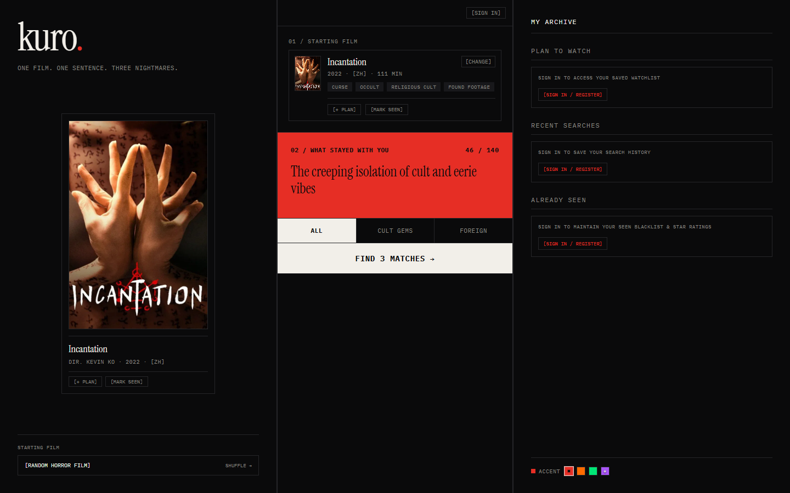
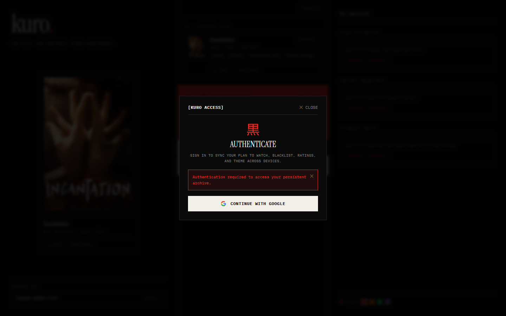

# kuro. / 黒

> **One film. One sentence. Three nightmares.**  
> A deterministic horror movie discovery engine with an austere neo-brutalist Japanese editorial grid aesthetic.

<p align="left">
  <a href="https://kuro.siddheshnaik.dev"></a>
  <a href="https://github.com/sidchigo/kuro/actions/workflows/deploy.yml"></a>
  <a href="LICENSE"></a>
  
</p>

| STACK | CORE AI / RERANKING | DATABASE & ORM | UI SYSTEM |
| :--- | :--- | :--- | :--- |
| **SvelteKit 2** + **Svelte 5** (Runes) | **EmbeddingGemma-300M** (ONNX / Q8) | **Drizzle ORM** + **SQLite** | **Tailwind CSS** (0px Brutalist Hairlines) |

---

## Preview

<p align="center">
  
</p>

<details>
<summary><b>View Authentication Modal & Access Control</b></summary>
<br />
<p align="center">
  
</p>
</details>

---

## Architecture & Tech Stack

- **Framework**: [SvelteKit 2](https://kit.svelte.dev/) with Node adapter (`@sveltejs/adapter-node`) for standalone persistent execution.
- **UI & State**: [Svelte 5](https://svelte.dev/) utilizing fine-grained reactive Runes (`$state`, `$derived`, `$props`).
- **Styling**: [Tailwind CSS](https://tailwindcss.com/) adhering strictly to an austere Japanese neo-brutalist grid (`0px` border-radius globally, `1px solid #262629` structural hairlines, zero blur/elevation dropshadows).
- **Typography**: Editorial serif typography (`Instrument Serif`), monospace control tags (`IBM Plex Mono`), and neutral sans-serif body (`Inter`).
- **Deterministic AI Embedding Engine**:
  - Local semantic vector inference powered by `@huggingface/transformers` running **EmbeddingGemma-300M** (`onnx-community/embeddinggemma-300m-ONNX`, Q8 quantized).
  - Matryoshka dimension reduction to **256 dimensions** for ultra-fast dot-product similarity.
  - Accelerated with ONNX Runtime WebAssembly SIMD multithreading in a dedicated background Web Worker.
  - Delta inference engine with persistent IndexedDB vector cache (<5ms cache hits).
  - 14 pre-computed **Horror Vibe Anchors** for grounded, deterministic thematic explanations.
  - Zero external LLM API fees, zero 429 rate-limit failures, and zero artificial hallucination slop.
- **Persistence & Multi-User RBAC**:
  - [Drizzle ORM](https://orm.drizzle.team/) with embedded SQLite (`data/kuro.db`). Runs locally with zero external database dependencies.
  - Role-Based Access Control (`Admin` and `Member`) with salted `scrypt` password hashing and Google OAuth 2.0 PKCE sign-in.
- **Production Infrastructure**:
  - Hosted on an Oracle Cloud VM running Node 20 LTS managed via systemd (`kuro.service`).
  - Nginx reverse proxy with WebSocket upgrade support, HTTP/1.1 proxying, and Cloudflare real-IP restoration.
  - Fully automated GitHub Actions CI/CD deployment pipeline.

---

## Features

### 1. 3-Column Responsive Editorial Grid
- **Left Column**: Brand wordmark (`kuro.`), dynamic TMDB poster stage with director, year, language, runtime badges, and 1-click `[RANDOM HORROR FILM] SHUFFLE` roll.
- **Center Column (430px Core)**: 
  - `01 / STARTING FILM`: Seed film selector with debounced TMDB search, quick seeds, and active ticket strip.
  - `02 / WHAT STAYED WITH YOU`: High-contrast Sentence Canvas with a 140-character limit and starter prompts.
  - `03 / POOL & TRIGGER`: Preset filters (`ALL` | `CULT GEMS` | `FOREIGN`) and discover trigger.
  - `04 / RESULTS STACK`: Editorial recommendation cards displaying calibrated match percentages, deterministic vibe anchor tags, 2-sentence pitches, and honest caveat notices (`CATCH:`).
- **Right Column (My Archive)**: Real-time user drawer featuring:
  - **Plan to Watch**: Watchlist dynamically ranked by taste affinity against films you've already seen.
  - **Recent Searches**: Remembers your recent seed films and pitches for 1-click restoration.
  - **Already Seen**: Blacklists previously watched films from candidate generation with interactive 1–5 star ratings.

### 2. 4-Slot Accent Theme Switcher
Customizable accent theme with instantaneous zero-flicker propagation across accents, star ratings, and the Sentence Canvas:
- **Crimson** (`#E62E25` — Default)
- **Amber** (`#FF6B00`)
- **Acid** (`#00E676`)
- **Custom**: Native color picker swatch allowing users to configure any hex accent.
- *Persistence*: Stored in `localStorage` for guests and synced to the database for authenticated users.

### 3. Dedicated Management Hubs
- **`/archive`**: Full-screen dedicated management interface for Plan to Watch, Already Seen, and Search History.
- **`/admin`**: Administrative control panel featuring:
  - **Users Directory**: Role management (`Admin` / `Member`), account deletion, and usage telemetry.
  - **Discovery Audit**: Real-time audit log of recent search queries, seeds, candidate counts, and match results.
  - **System Metrics**: Visual overview of total users, discoveries, and active sessions.

---

## Directory Structure

```text
kuro/
├── .github/workflows/       # GitHub Actions automated VM deployment pipeline
├── data/                    # Local SQLite database storage (auto-created)
├── docs/                    # Documentation & screenshots
│   └── screenshots/         # UI preview captures
├── static/                  # Static assets (favicons, service-worker cleanup)
├── src/
│   ├── components/          # Svelte 5 UI components (Runes)
│   │   ├── AccentSwitcher.svelte    # 4-slot theme switcher
│   │   ├── AuthModal.svelte         # Google OAuth & Local credentials modal
│   │   ├── KuroApp.svelte           # Main reactive shell coordinator
│   │   ├── LeftColumn.svelte        # Brand header & dynamic poster stage
│   │   ├── RightColumn.svelte       # Archive sidebar (Watchlist / Seen / Seeds)
│   │   ├── SentenceCanvas.svelte    # 140-char pitch textarea
│   │   ├── PresetTrigger.svelte     # Presets (All / Cult / Foreign) & Run
│   │   ├── ResultsStack.svelte      # 3-nightmare match cards
│   │   └── TopBar.svelte            # Header bar with auth controls
│   ├── lib/                 # Core utilities & domain services
│   │   ├── client/          # Discovery client & taste affinity scoring
│   │   ├── stores/          # Svelte 5 reactive stores (library, theme)
│   │   ├── auth.ts          # Session management & scrypt hashing
│   │   ├── constants.ts     # Centralized thresholds, genres & language maps
│   │   ├── db.ts            # Drizzle ORM client & automated migrations
│   │   ├── discoveryService.ts # Orchestrator for waterfall + semantic reranking
│   │   ├── embeddings.ts    # EmbeddingGemma ONNX runtime & vector caching
│   │   ├── matchFormatters.ts # Vibe anchors, calibration & caveat generators
│   │   ├── schema.ts        # Database schema definitions
│   │   ├── tmdb.ts          # TMDB API queries & hydration
│   │   └── waterfall.ts     # Multi-tier candidate discovery waterfall
│   ├── routes/              # SvelteKit pages & API endpoints
│   │   ├── admin/           # Dedicated Admin Panel
│   │   ├── archive/         # Dedicated User Archive
│   │   └── api/             # REST endpoints (auth, discover, user library)
│   └── workers/             # Embedding Web Worker (Transformers.js / ONNX)
├── nginx-kuro.conf          # Nginx reverse proxy configuration for production VM
├── svelte.config.js         # SvelteKit adapter configuration (Node adapter)
├── tailwind.config.mjs      # Tailwind configuration & typography
└── vite.config.ts           # Vite build pipeline with WebAssembly support
```

---

## Getting Started

### 1. Prerequisites
- **Node.js**: `v20.x` or higher
- **npm**: `v10.x` or higher

### 2. Installation
```bash
git clone https://github.com/sidchigo/kuro.git
cd kuro
npm install
```

### 3. Environment Setup
Copy the sample environment file:
```bash
cp .env.example .env
```

Configure your `.env` variables:
```env
# TMDB API Key (Required for posters and movie metadata)
# Get a free key at: https://www.themoviedb.org/settings/api
TMDB_API_KEY=your_tmdb_api_key_here

# Optional: Google OAuth (For 1-click sign-in)
# If omitted, local username & password auth works out of the box with zero setup!
GOOGLE_CLIENT_ID=
GOOGLE_CLIENT_SECRET=
ADMIN_EMAIL=your_email@gmail.com

# Optional: Custom Port (Defaults to 4322 or 3000)
# PORT=4322
```

### 4. Development
Start the local development server:
```bash
npm run dev
```
Open [http://localhost:5173](http://localhost:5173) in your browser.

> [!TIP]
> You can immediately log in as the default administrator using:
> - **Username**: `admin`
> - **Password**: `kuroadmin123`

---

## Visual Database Studio

Kuro includes [Drizzle Studio](https://orm.drizzle.team/drizzle-studio/overview) for exploring and managing database tables directly in your browser:

```bash
npm run db:studio
```
Opens Drizzle Studio at `https://local.drizzle.studio`.

---

## Production Build & Deployment

### Manual Build
```bash
npm run build
npm run start
```
Starts the standalone Node.js production server on `http://127.0.0.1:4322` (or the configured `PORT`).

### Automated CI/CD (GitHub Actions to VM)
Every push to the `main` branch triggers [.github/workflows/deploy.yml](.github/workflows/deploy.yml), which:
1. Validates types and executes `npm run check`.
2. Compiles the production SvelteKit bundle via `@sveltejs/adapter-node`.
3. Securely transfers and unpacks the release archive to your remote VM via SSH.
4. Restarts the `kuro.service` systemd unit and runs an automated health check.
5. Verifies the public edge URL at `https://kuro.siddheshnaik.dev`.

To configure for your own server, set these secrets in **GitHub &rarr; Settings &rarr; Secrets and variables &rarr; Actions**:
- `VM_SSH_KEY`: Your OpenSSH private key
- `VM_HOST`: Target server IPv4 or domain
- `VM_USER`: Server username (e.g. `ubuntu`)

---

## License

MIT © [Siddhesh Naik](https://github.com/sidchigo)
